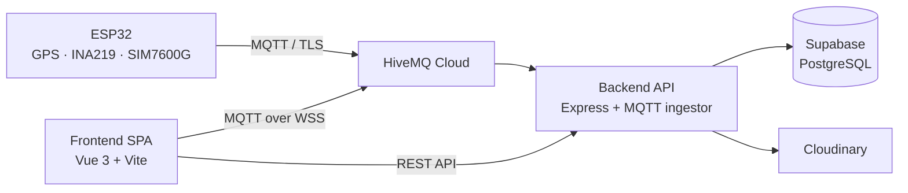

# MyMektan


MyMektan (sebelumnya disebut Si-Alsintan) adalah platform berbasis Internet of Things (IoT) untuk memantau lokasi, status mesin, tegangan aki, jam kerja, dan estimasi luas lahan alsintan (alat dan mesin pertanian). Sistem ini dikembangkan untuk mendukung operasional UPTD Balai Pengembangan Mekanisasi Pertanian Provinsi Jawa Barat.

## Arsitektur Sistem



Alur data utama:

1. Perangkat ESP32 mengirim data lokasi dan telemetri ke topik MQTT.
2. Backend memvalidasi data, menghitung status mesin, jam kerja, dan jarak kerja, lalu menyimpannya ke PostgreSQL.
3. Frontend mengambil data historis melalui REST API dan menerima pembaruan realtime melalui MQTT over WSS.
4. Admin mengelola aset, memverifikasi akun, dan memproses pengajuan peminjaman melalui antarmuka web.

## Fitur Utama

- Pemantauan lokasi dan status mesin secara realtime.
- Telemetri tegangan aki, arus, dan kualitas sinyal GPS.
- Perhitungan hour meter dan jarak kerja traktor.
- Estimasi luas lahan dan biaya jasa berdasarkan riwayat perjalanan.
- Katalog aset publik dengan detail spesifikasi dan ketersediaan.
- Pengajuan peminjaman alsintan oleh masyarakat.
- Antrean pengajuan dan penerbitan surat jalan digital dengan QR code.
- Registrasi akun UPJA dan verifikasi oleh admin Mektan.
- Manajemen aset dengan unggah gambar.
- Autentikasi JWT dengan pembatasan satu sesi aktif per akun.

## Peran Pengguna

| Peran | Akses utama |
| --- | --- |
| Guest | Dashboard, katalog aset, detail aset, pengajuan peminjaman, dan registrasi akun. |
| UPJA | Login, profil, monitoring peta, estimasi lahan, dan pengajuan peminjaman. |
| Mektan | Seluruh fitur UPJA ditambah manajemen aset, verifikasi akun, pengelolaan antrean, dan transaksi peminjaman. |

Registrasi publik membuat akun dengan role `upja` dan status `pending`. Akun baru dapat digunakan setelah diverifikasi oleh admin `mektan`.

## Struktur Repositori

```text
web_mektan_v2/
├── backend/    # REST API, autentikasi, dan MQTT ingestor
├── frontend/   # Single-page application Vue 3
├── esp/        # Firmware ESP32
├── docs/       # Dokumentasi per layer sistem
├── log/        # Catatan pengembangan
└── assets/     # Gambar, skematik, dan aset dokumentasi
```

| Komponen | Deskripsi | Dokumentasi |
| --- | --- | --- |
| Backend | API Express, autentikasi JWT, integrasi MQTT, dan akses database. | [backend/README.md](backend/README.md) |
| Frontend | SPA Vue 3 untuk monitoring, katalog aset, dan alur peminjaman. | [frontend/README.md](frontend/README.md) |
| Firmware | Firmware ESP32 untuk sensor, GPS, dan komunikasi MQTT. | [esp/README.md](esp/README.md) |
| Perception Layer | Dokumentasi sensor dan perangkat keras. | [docs/perception.md](docs/perception.md) |
| Network Layer | Dokumentasi jaringan, AT command, dan MQTT. | [docs/network.md](docs/network.md) |
| Application Layer | Dokumentasi layer aplikasi. | [docs/application.md](docs/application.md) |

## Teknologi

| Layer | Teknologi |
| --- | --- |
| Firmware | ESP32, PlatformIO, Arduino C++, FreeRTOS |
| Messaging | MQTT over TLS (HiveMQ Cloud) |
| Backend | Node.js, Express 5, PostgreSQL (Supabase), JWT, Cloudinary |
| Frontend | Vue 3, Vite, Vue Router, Bootstrap 5, Leaflet, MQTT.js, Axios |
| Deployment | Render (backend) dan Vercel (frontend) |

## Menjalankan Proyek

### Prasyarat

- Node.js 22 LTS dan npm.
- Proyek Supabase (PostgreSQL).
- Broker HiveMQ Cloud.
- Akun Cloudinary.
- Git.

### 1. Clone repositori

```bash
git clone https://github.com/mynkhalid/web_mektan_v2.git
cd web_mektan_v2
```

### 2. Siapkan database

1. Buat proyek baru di Supabase.
2. Buka SQL Editor pada dashboard Supabase.
3. Jalankan seluruh isi file [`backend/db_alsintan.sql`](backend/db_alsintan.sql).
4. Salin connection string PostgreSQL dari menu **Project Settings → Database** untuk digunakan sebagai `DATABASE_URL`.

Alternatif melalui `psql`:

```bash
psql "$DATABASE_URL" -f backend/db_alsintan.sql
```

### 3. Jalankan backend

```bash
cd backend
npm install
cp .env.example .env
# Windows: copy .env.example .env
```

Lengkapi variabel di `.env`, lalu jalankan:

```bash
node index.js
```

Backend berjalan di `http://localhost:3000`. Daftar variabel dan dokumentasi API tersedia di [backend/README.md](backend/README.md).

### 4. Jalankan frontend

```bash
cd frontend
npm install
cp .env.example .env
# Windows: copy .env.example .env
```

Sesuaikan variabel di `.env`, lalu jalankan:

```bash
npm run dev
```

Frontend berjalan di `http://localhost:5173`. Daftar variabel dan dokumentasi halaman tersedia di [frontend/README.md](frontend/README.md).

## Konfigurasi Environment

Template environment tersedia di:

- [`backend/.env.example`](backend/.env.example)
- [`frontend/.env.example`](frontend/.env.example)

Salin template tersebut menjadi `.env` dan isi nilainya. File `.env` tidak boleh di-commit ke repositori.

## Deployment

| Komponen | Platform | Catatan |
| --- | --- | --- |
| Frontend | Vercel | Build command `npm run build`, output `dist`. Tambahkan environment variable frontend di dashboard Vercel. |
| Backend | Render | Root directory `backend`, build command `npm install`, start command `node index.js`. Tambahkan environment variable backend di dashboard Render. |
| Database | Supabase | Jalankan `backend/db_alsintan.sql` melalui SQL Editor. Gunakan connection string Supabase sebagai `DATABASE_URL`. |
| MQTT | HiveMQ Cloud | Port `8883` untuk backend (TLS) dan port `8884` untuk frontend (WSS). |
| Penyimpanan gambar | Cloudinary | Digunakan untuk gambar aset dan foto profil. |

Backend saat ini mengizinkan origin `http://localhost:5173` dan `https://mymektan.vercel.app` pada konfigurasi CORS di [`backend/index.js`](backend/index.js). Sesuaikan daftar tersebut jika domain frontend berubah.

## Dokumentasi

- [Backend](backend/README.md): setup, environment variable, API reference, kontrak MQTT, dan deployment Render.
- [Frontend](frontend/README.md): setup, environment variable, daftar halaman, autentikasi, dan deployment Vercel.
- [Firmware ESP32](esp/README.md): arsitektur firmware, debugging, dan dokumentasi perangkat keras.
- [Perception Layer](docs/perception.md)
- [Network Layer](docs/network.md)
- [Application Layer](docs/application.md)

Dokumentasi application layer tersedia di [`docs/application.md`](docs/application.md). Untuk konfigurasi rinci dan referensi API, gunakan README backend dan frontend di atas.

## Kontribusi

Lihat [CONTRIBUTING.md](CONTRIBUTING.md) untuk informasi kontribusi dan daftar kontributor.

Proyek ini menggunakan [Semantic Versioning](https://semver.org/) dengan format `MAJOR.MINOR.PATCH`. Untuk alur sinkronisasi repositori, tersedia `git_sync.bat` (Windows) dan `git_sync.sh` (shell).

## Lisensi

MyMektan adalah perangkat lunak proprietary milik UPTD Balai Pengembangan Mekanisasi Pertanian Provinsi Jawa Barat. Seluruh hak dilindungi. Ketentuan penggunaan selengkapnya tersedia di [LICENSE.md](LICENSE.md).
